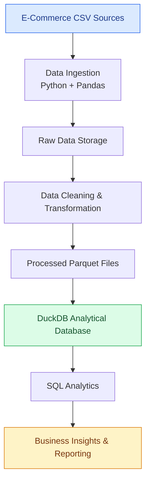

# E-Commerce Analytics Pipeline

An end-to-end batch data engineering pipeline that ingests
e-commerce data, transforms raw records, generates Parquet
files, and loads analytical datasets into DuckDB.

## Architecture
