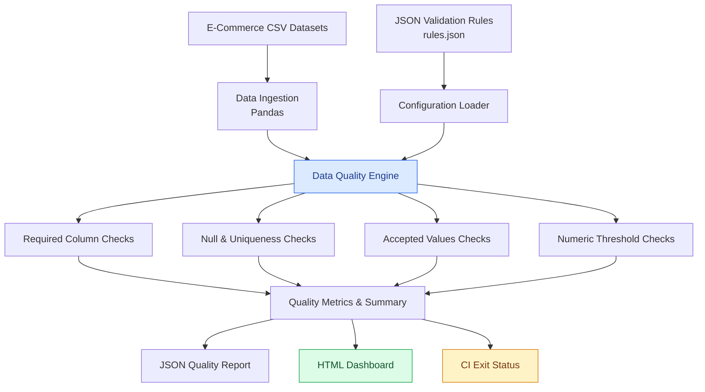

# 03 — Data Quality Monitoring Framework

A configuration-driven data quality monitoring framework built with Python, Pandas, JSON and Pytest. It validates e-commerce datasets against configurable quality rules, generates detailed JSON and HTML reports, and returns CI-friendly exit codes.

## Overview

This project implements a reusable data quality validation engine for monitoring the reliability and consistency of e-commerce data.

It validates multiple datasets independently, calculates quality metrics, identifies failed records, and generates reports for analysis and automated workflows.

## Architecture



## Features

- Configuration-driven validation using JSON rules.
- Required column validation.
- Null value detection.
- Duplicate record detection.
- Accepted value validation.
- Numeric threshold validation.
- Independent validation of multiple datasets.
- Dataset-level and overall quality metrics.
- Pass-rate calculations.
- Detailed JSON quality reports.
- Interactive browser-friendly HTML dashboard.
- CI-friendly exit codes.
- Automated testing with Pytest.

## Supported Validation Rules

| Rule | Description |
|---|---|
| `required_columns` | Checks whether required columns exist |
| `not_null` | Detects missing values |
| `unique` | Identifies duplicate records |
| `accepted_values` | Validates values against an approved list |
| `greater_than` | Checks whether numeric values exceed a threshold |
| `greater_equal` | Checks whether numeric values meet a minimum threshold |

## Datasets Monitored

The framework currently validates four datasets:

| Dataset | Quality Checks |
|---|---:|
| Orders | 10 |
| Customers | 4 |
| Products | 4 |
| Payments | 6 |
| **Total** | **24** |

## Configuration

Validation rules are maintained in:

`config/rules.json`

Example:

```json
{
  "orders": [
    {
      "name": "order_id_unique",
      "type": "unique",
      "column": "order_id"
    },
    {
      "name": "quantity_positive",
      "type": "greater_than",
      "column": "quantity",
      "value": 0
    }
  ]
}
```

New rules can be added or existing rules modified without changing the validation engine, provided the rule type is supported.

## Project Structure

```text
03-data-quality-monitoring-framework/
│
├── config/
│   └── rules.json
│
├── src/
│   ├── __init__.py
│   └── quality.py
│
├── tests/
│   └── test_quality.py
│
├── reports/
│   ├── quality_report.json
│   └── quality_report.html
│
├── datasets/
│
├── run_quality.py
├── requirements.txt
├── pytest.ini
└── README.md
```

The shared synthetic datasets are maintained in the repository-level `datasets/` directory.

## Installation

Navigate to the project directory:

```bash
cd 03-data-quality-monitoring-framework
```

Install dependencies:

```bash
pip install -r requirements.txt
```

## Running the Framework

Execute the quality monitoring pipeline:

```bash
python run_quality.py --data-dir ../datasets --config config/rules.json --report-dir reports
```

The pipeline:

1. Loads the configured validation rules.
2. Reads the corresponding CSV datasets.
3. Executes validation checks.
4. Calculates dataset-level quality metrics.
5. Calculates overall quality metrics.
6. Generates JSON and HTML reports.
7. Returns an appropriate process exit code.

## Generated Reports

**1. JSON Quality Report**

`reports/quality_report.json`

Contains:
- Dataset row counts.
- Individual validation results.
- Passed and failed checks.
- Dataset pass rates.
- Overall quality status.
- Report generation timestamp.

**2. HTML Quality Dashboard**

`reports/quality_report.html`

Provides a browser-based view of:
- Overall quality status.
- Total datasets monitored.
- Total records evaluated.
- Passed and failed checks.
- Overall pass rate.
- Detailed rule-level validation results.

Open the HTML report in your browser to inspect the results.

## Current Validation Results

The current synthetic dataset validation completed successfully:

| Dataset | Passed | Failed | Status |
|---|---:|---:|---|
| Orders | 10 | 0 | PASS |
| Customers | 4 | 0 | PASS |
| Products | 4 | 0 | PASS |
| Payments | 6 | 0 | PASS |

**Overall: 24/24 checks passed.**

## Automated Testing

Run the complete test suite:

```bash
pytest -v
```

The automated tests cover:

- Duplicate detection.
- Accepted value validation.
- Required column validation.
- Null value detection.
- Numeric threshold validation.
- JSON report generation.
- HTML report generation.
- Missing dataset handling.

**Current test result: 8 passed.**

## CI/CD Integration

The framework supports continuous integration through GitHub Actions.

The runner returns:
- Exit code `0` when all configured checks pass.
- Exit code `1` when one or more datasets fail validation.

This allows automated workflows to detect data quality failures and stop downstream processes when necessary.

## Technology Stack

- Python
- Pandas
- JSON
- HTML / CSS
- Pytest
- Git
- GitHub Actions

## Future Improvements

- Schema and data type validation.
- Email and Slack alerts for failed checks.
- Historical quality trend tracking.
- Configurable severity levels.
- Database integration.
- Scheduled quality monitoring.

## Author

**Anubhab Kalita**

Data Engineering Portfolio Project

